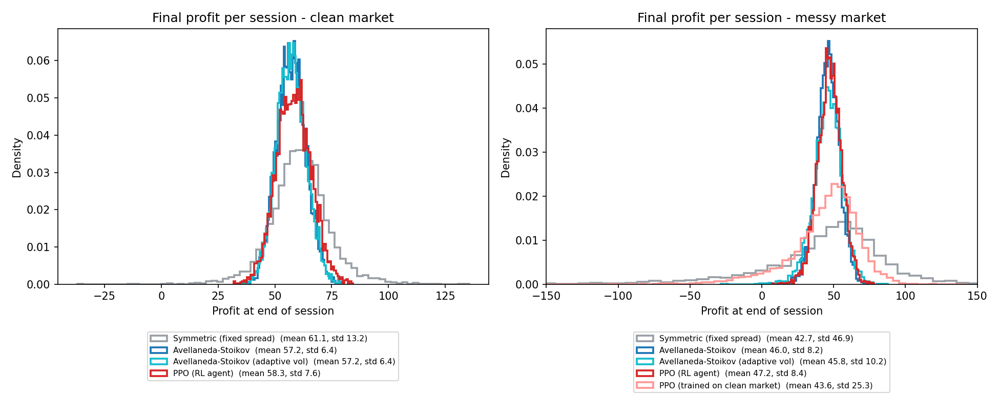
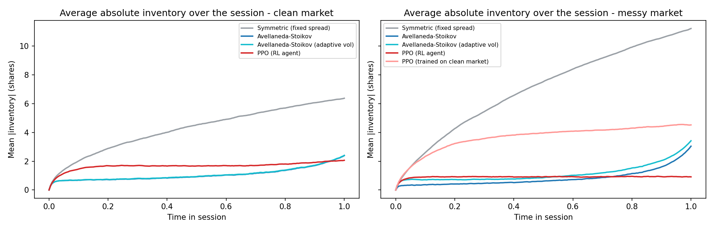
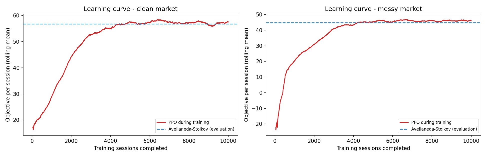
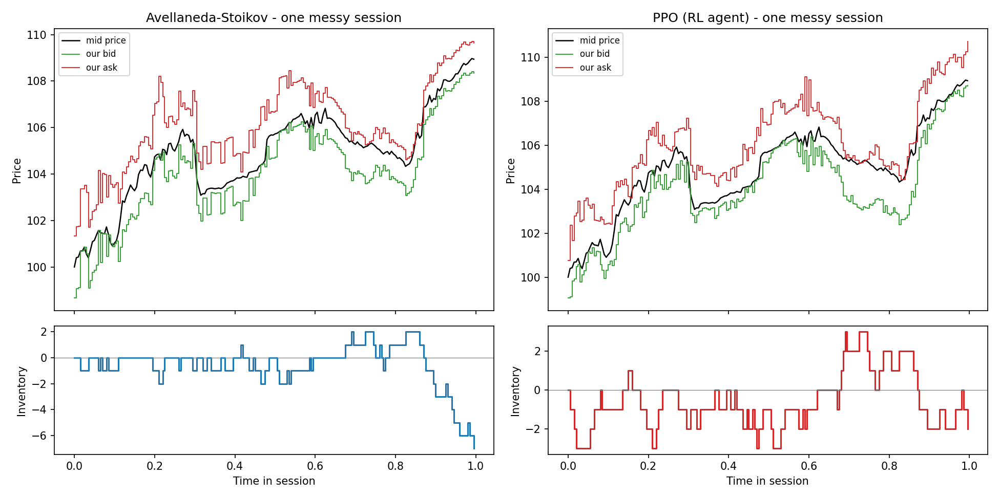

# Can Reinforcement Learning Beat Avellaneda-Stoikov? An RL Market Maker

A market-making simulator, a classic benchmark strategy, and a PPO reinforcement-learning agent, compared head to head on 5,000 identical simulated trading sessions in two market regimes.

**Question:** Avellaneda & Stoikov (2008) derived a closed-form market-making strategy. Can a reinforcement-learning agent that learns purely from simulated experience match or beat it, and what happens when the market stops obeying the formula's assumptions?

## Key findings

| | Clean market (formula's assumptions hold) | Messy market (assumptions broken) |
|---|---|---|
| **RL vs. Avellaneda-Stoikov** | RL ahead by **+0.61** risk-adjusted score (95% CI +0.48 to +0.75) | RL ahead by **+1.44** (95% CI +1.26 to +1.61), but see "Variability between training runs" |
| **Inventory held at end of session** | RL 2.1 shares vs. 2.4 | RL 0.9 shares vs. 3.0 |
| **Agent trained on the *other* market** | n/a | Collapses: score 27.3 vs. 44.7 for Avellaneda-Stoikov |

1. **In the clean market, RL edges out the formula.** The edge is small (about 1% of the score) but consistent across training runs. Avellaneda-Stoikov is derived with continuous-time approximations, so it is near-optimal rather than exactly optimal in a discrete simulator.
2. **In the messy market, RL is at least as good as the formula, with a much smaller inventory.** The size of its edge varied a lot between two training runs (from a tie to +1.44), so I treat it as unproven. See the variability section below.
3. **RL is fragile to distribution shift; the formula is not.** An agent trained only on the clean market scored about 40% below Avellaneda-Stoikov when dropped into the messy one, while the formula, which has no training to go stale, held up. This is the most practically important result.
4. **Estimating volatility on the fly hurts.** An adaptive Avellaneda-Stoikov that estimates volatility from the last ~20 price changes scored 1.3 points worse than one given the true long-run volatility in the messy market.

## How it works

### The simulated market (`src/market.py`)
- A stock's mid price follows a random walk. Buy and sell orders arrive randomly, and the arrival rate falls exponentially the further our quote sits from the mid price (`A * exp(-k * distance)`).
- Parameters in the clean market (sigma=2, A=140, k=1.5, 200 steps per session) follow the Avellaneda-Stoikov paper's own simulation.
- **Messy mode** adds things real markets have: volatility that flips between calm and stormy regimes, occasional price jumps, and a short-lived price drift with order flow leaning in the same direction (adverse selection: buyers show up right before the price rises).
- Price paths are independent of the agent's actions, so every strategy is tested on **identical price paths and fill randomness**.

### The strategies
| Strategy | Description |
|---|---|
| Symmetric | Same distance either side of mid, ignores inventory. Spread set to Avellaneda-Stoikov's average. |
| Avellaneda-Stoikov | Quotes around a *reservation price* that shifts against inventory, with a spread that widens with volatility and time left. Given the market's true overall volatility. |
| Avellaneda-Stoikov (adaptive) | Same formula, volatility estimated from recent price changes. |
| PPO agent | Neural network (2 x 64) trained with PPO from Stable-Baselines3. |

### The RL setup (`src/env.py`)
- **State (6 numbers):** inventory, fraction of session left, last price change, recent trend, recent volatility, recent order flow.
- **Action (2 numbers):** distance of the bid below mid and the ask above mid.
- **Reward:** change in wealth minus `(gamma/2) * sigma^2 * inventory^2 * dt`. This inventory penalty is the same risk cost the Avellaneda-Stoikov formula assumes, so both approaches optimise the **same objective**, which keeps the comparison fair.
- Each agent was trained for 2 million steps (about 10,000 sessions), roughly 8 minutes on a laptop CPU.

## Results (5,000 evaluation sessions per market)

**Objective** = profit minus the inventory risk penalty (what the agent was trained to maximise). Confidence intervals come from a paired bootstrap over sessions.

### Clean market
| Strategy | Mean profit | Profit std | Sharpe (per session) | Mean abs. final inventory | Objective | vs. A-S (95% CI) |
|---|---|---|---|---|---|---|
| Symmetric | 61.10 | 13.17 | 4.64 | 6.37 | 54.62 | -2.17 (-2.57, -1.79) |
| Avellaneda-Stoikov | 57.24 | 6.41 | 8.93 | 2.39 | 56.79 | - |
| Avellaneda-Stoikov (adaptive) | 57.21 | 6.44 | 8.88 | 2.40 | 56.75 | -0.04 (-0.09, +0.01) |
| **PPO** | 58.33 | 7.64 | 7.63 | 2.06 | **57.40** | **+0.61 (+0.48, +0.75)** |

### Messy market
| Strategy | Mean profit | Profit std | Sharpe (per session) | Mean abs. final inventory | Objective | vs. A-S (95% CI) |
|---|---|---|---|---|---|---|
| Symmetric | 42.69 | 46.87 | 0.91 | 11.20 | -20.37 | -65.11 (-68.04, -62.14) |
| Avellaneda-Stoikov | 45.96 | 8.16 | 5.63 | 3.04 | 44.74 | - |
| Avellaneda-Stoikov (adaptive) | 45.78 | 10.17 | 4.50 | 3.42 | 43.43 | -1.32 (-1.51, -1.12) |
| **PPO** | 47.24 | 8.35 | 5.66 | 0.91 | **46.19** | **+1.44 (+1.26, +1.61)** |
| PPO trained on clean market | 43.55 | 25.29 | 1.72 | 4.52 | 27.26 | -17.49 (-18.43, -16.53) |

Profit is in simulated price units. Note that the symmetric strategy earns the highest *average* profit in the clean market but with twice the volatility and far more inventory risk, which is why it loses on the risk-adjusted objective.

### Figures
| | |
|---|---|
|  | Distribution of final profit per session |
|  | Average absolute inventory through the session |
|  | PPO learning curves against the Avellaneda-Stoikov level |
|  | One messy session: quotes, price, and inventory |

## Variability between training runs

I trained each agent twice with the same code and the same random seed, on two different machines. Neural-network training is not exactly repeatable across hardware and library versions, so the two runs produced different agents:

| Training run | Clean: RL vs. A-S | Messy: RL vs. A-S | Clean-trained agent in messy market (vs. A-S) |
|---|---|---|---|
| Run 1 (tables above) | +0.61 | +1.44 | -17.49 |
| Run 2 | +0.78 | +0.08 (95% CI -0.11, +0.26: a tie) | -22.36 |

The confidence intervals in the tables only measure noise from the 5,000 test sessions. They do **not** include the run-to-run randomness of training, which is clearly larger for the messy market. What holds in both runs: RL is at least as good as Avellaneda-Stoikov in both markets, the clean-market edge is small and consistent, agents trained on one market break in another, adaptive volatility estimation hurts, and the symmetric strategy is far worse. How large RL's messy-market edge really is would need many training seeds to pin down.

## Limitations (read these before drawing conclusions)

- **This is a simulation, not a trading result.** There is no real order book, queue position, fees, latency, or market impact. Nothing here says the strategy would make money in a live market.
- **Only two training runs per market.** The runs disagree on the size of the messy-market edge (see above). A proper study would train many seeds and report the spread.
- **The messy market is my own design.** How much RL gains there depends on how I built the market (and on untuned hyperparameters), not on a general truth about real markets.
- **Order flow structure is shared.** Both the simulator and the Avellaneda-Stoikov derivation assume exponential fill rates, which favours the formula in the clean market.
- **Absolute profits differ from the paper.** I cap each fill probability at 1 (`1 - exp(-lambda*dt)`) where the paper uses the linear approximation `lambda*dt`, so my profits run roughly 10% lower. The qualitative pattern the paper reports (the formula roughly halves profit volatility versus a symmetric strategy) is reproduced.
- Single stock, order size fixed at 1, no hyperparameter tuning.

## Reproduce it

```bash
pip install -r requirements.txt

python -m src.train --regime clean --steps 2000000     # ~8 min on a laptop CPU
python -m src.train --regime messy --steps 2000000     # ~8 min
python -m src.evaluate                                 # tables + figures into ./results
python -m pytest -q                                    # sanity tests
```

## Project layout

```
src/market.py        simulator (clean and messy modes)
src/avellaneda.py    Avellaneda-Stoikov and symmetric baselines
src/env.py           Gymnasium environment (state, action, reward)
src/train.py         PPO training
src/evaluate.py      head-to-head evaluation, statistics, plots
tests/               sanity tests (accounting, skew direction, fair-test property)
results/             tables and figures
models/              trained agents
```

## Reference

Avellaneda, M. & Stoikov, S. (2008). *High-frequency trading in a limit order book.* Quantitative Finance, 8(3), 217-224.
